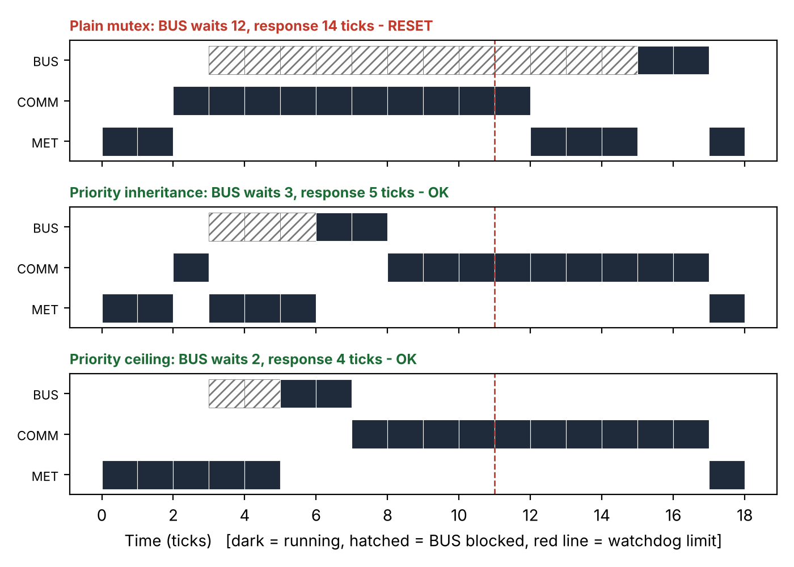
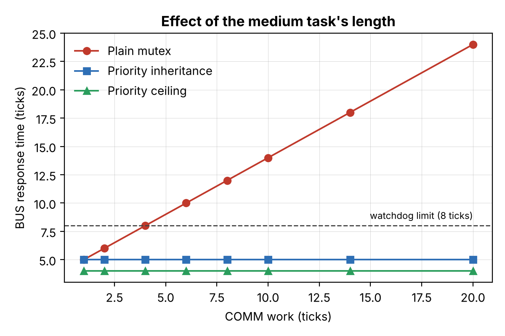

# Priority Inversion Simulator

**Operating System (CIC-309) – Mini Project** · Krishna Rawat · 00614803124 · B.Tech IT, 5th Semester (5I1)

A small Python simulator that reproduces **priority inversion** (the bug that kept resetting the Mars Pathfinder computer in 1997) and compares three ways of handling a shared lock:

| Policy | Rule |
|---|---|
| **Plain mutex** (`none`) | No protection. A medium-priority task can keep the CPU while a high-priority task waits. |
| **Priority inheritance** (`inherit`) | The lock holder takes the priority of the highest-priority waiting task until it unlocks. This was the Pathfinder fix. |
| **Priority ceiling** (`ceiling`) | The lock holder runs at the mutex's ceiling (highest priority of any user) from the moment it locks. |

This project extends my case study *"Priority Inversion on Mars Pathfinder (1997)"*.

## The scenario (1 tick = 1 time unit)

| Task | Priority | Ready at | Script |
|---|---|---|---|
| MET (low) | 1 | tick 0 | lock bus, 5 ticks of work, unlock, 1 more tick |
| COMM (medium) | 2 | tick 2 | 10 ticks of work, never uses the bus |
| BUS (high) | 3 | tick 3 | lock bus, 2 ticks of work, unlock |

BUS must finish within **8 ticks** of becoming ready, otherwise the watchdog resets the system.
The numbers are invented for illustration; they are not the real Pathfinder timings.

## Quick start

```bash
pip install -r requirements.txt        # only needed for charts (matplotlib)
python simulate.py --scenario pathfinder
python simulate.py --policy inherit    # one policy only
python simulate.py --comm 4            # shorter medium task
python simulate.py --sweep             # vary COMM length 1..20
python simulate.py --plot              # save charts to outputs/
python -m unittest discover -s tests -v
```

Python 3.8+ is enough. The simulator itself uses only the standard library.

## Output

```
$ python simulate.py --scenario pathfinder
POLICY      BUS-WAIT  BUS-DONE  RESPONSE  COMM-WHILE-WAIT  WATCHDOG(8)
plain           12        17        14             9      RESET at t=11
inherit          3         8         5             0      OK (3 spare)
ceiling          2         7         4             0      OK (4 spare)

tick     0  1  2  3  4  5  6  7  8  9 10 11 12 13 14 15 16 17
plain      L  L  M  M  M  M  M  M  M  M  M  M  L  L  L  H  H  L
inherit    L  L  M  L  L  L  H  H  M  M  M  M  M  M  M  M  M  L
ceiling    L  L  L  L  L  H  H  M  M  M  M  M  M  M  M  M  M  L
(L = MET, M = COMM, H = BUS)
```

Charts written by `--plot`: `outputs/timeline.png` (one timeline per policy) and `outputs/sweep.png` (BUS response time against COMM length).




## Results

- With a plain mutex COMM runs for 9 ticks while BUS waits, BUS finishes at tick 17 and the 8-tick limit is passed (**RESET**).
- With a plain mutex the BUS response time is always `COMM length + 4` (checked for COMM = 1 … 20), so the limit is passed once COMM needs more than 4 ticks.
- BUS response stays at **5 ticks** with inheritance and **4 ticks** with ceiling, whatever the COMM length.
- Trade-off: ceiling is slightly faster because COMM never preempts the lock holder, but it needs every user of the mutex to be known in advance. Inheritance only reacts when a task actually waits.

## How it works

Every tick, the scheduler (`pisim/scheduler.py`):
1. releases tasks that become ready,
2. performs zero-time lock/unlock steps and asks the policy (`pisim/policies.py`) to adjust effective priorities,
3. runs the ready task with the highest effective priority for one tick,
4. repeats until all tasks finish, then computes wait time, response time and the watchdog verdict.

A task is a script: `L` = lock, `U` = unlock, `C` = one tick of CPU work. A new scenario is just a list of `Task(name, priority, release, script)` objects (see `pisim/scenarios.py`).

## Project structure

```
priority-inversion-simulator/
├── simulate.py            command-line interface
├── pisim/
│   ├── scheduler.py       Task, Scenario, Result and the tick loop
│   ├── policies.py        plain mutex, priority inheritance, priority ceiling
│   ├── scenarios.py       the Pathfinder-style scenario
│   ├── report.py          comparison table and timeline text
│   └── plot.py            timeline and sweep charts (matplotlib)
├── tests/test_scheduler.py   9 unit tests
├── outputs/               generated charts
├── requirements.txt
└── LICENSE
```

## Mapped SDG

SDG 9 – Industry, Innovation and Infrastructure · SDG 4 – Quality Education

## References

NASA, *Sojourner Arrives on the Red Planet*; M. Jones, *What really happened on Mars?*; G. Reeves, *What really happened on Mars Rover Pathfinder*; Rapita Systems, *What really happened to the software on the Mars Pathfinder spacecraft?*

## License

MIT – see `LICENSE`.
